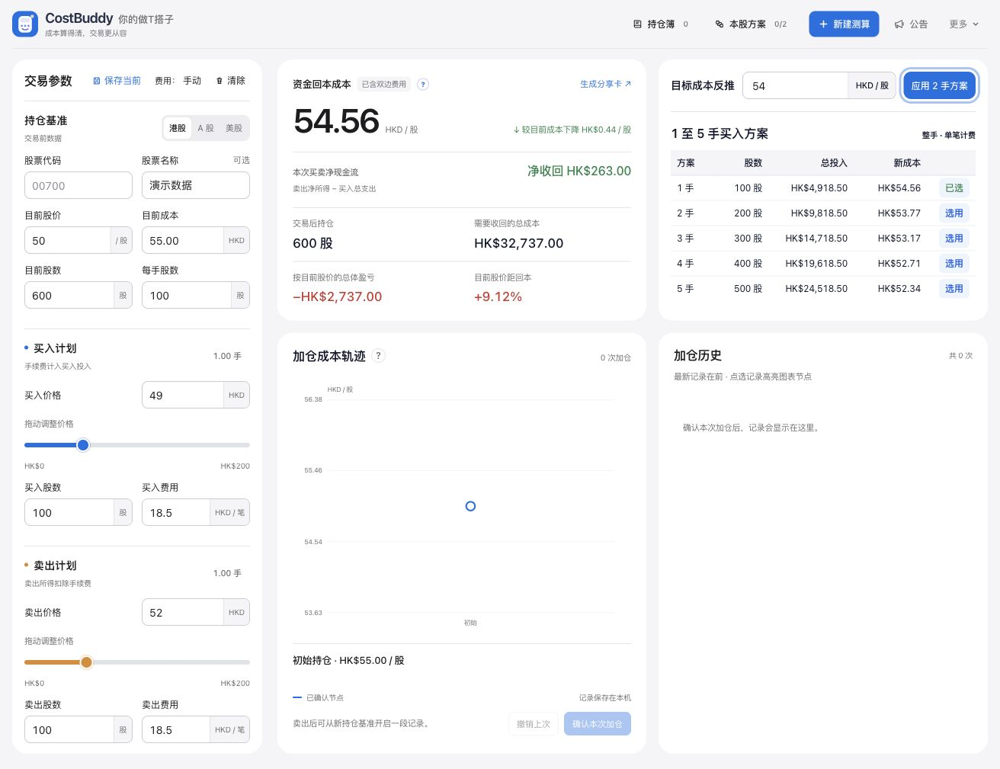

<div align="center">


# CostBuddy 你的做T搭子

**做 T、加仓、减仓，先看成本怎么变。**

输入当前持仓与买卖计划，查看交易后的回本成本、剩余持仓和资金变化。

[在线使用 →](https://costbuddy.space/) · [使用说明](https://costbuddy.space/USER_GUIDE.html)

港股 / A 股 / 美股 · 无需注册 · 浏览器本地测算

</div>

---

## 工作台实览



*当前版本的实际界面，使用虚构演示数据：600 股、成本 HK$55，计划以 HK$52 卖出 100 股、以 HK$49 买入 100 股，双边费用各 HK$18.50。测算后的回本成本为 HK$54.56 / 股。截图不代表真实持仓或行情。*

## 从一笔交易计划开始

1. **选择市场**：港股、A 股或美股，填写当前股数、每股成本与当前股价。
2. **填写计划**：输入准备买入或卖出的价格、股数及费用。
3. **查看变化**：检查回本成本、交易后持仓、资金投入与卖出净所得。
4. **比较再决定**：调整价格和数量，或保存方案 A / B 对比。

> 测算依据你填写的价格和费用，不预测行情，也不会替你执行交易。

## 把成本变化看清楚

| 想解决的问题 | 可以使用的功能 |
| --- | --- |
| 这次买卖后，成本变成多少？ | 同时测算买入与卖出，汇总回本成本、剩余持仓与资金明细 |
| 买多少才能达到目标成本？ | 目标成本反推，结合市场的整手或整股单位给出方案 |
| 两个计划哪个更合适？ | 保存方案 A / B，比较资金与成本；查看不同买入数量的方案 |
| 多次加仓后，成本如何变化？ | 加仓成本轨迹与加仓历史，记录并查看成本变化 |
| 多只股票如何继续测算？ | 持仓簿保存各股票参数，支持 JSON 备份与恢复 |
| 如何展示这次测算？ | 复制结果、分享测算链接或生成图片；图片默认隐藏股数和资金金额 |

支持桌面与手机布局，以及日间 / 夜间模式。详细操作见[使用说明](https://costbuddy.space/USER_GUIDE.html)。

## 三个市场，分别设置

| 市场 | 数量方案 | 费用方式 |
| --- | --- | --- |
| 港股 | 按设置的每手股数，比较 1–5 手方案 | 手动填写，或按配置参数估算 |
| A 股 | 每手默认 100 股，可调整；比较 1–5 手方案 | **仅手动填写实际总费用**，默认 0 表示未计费用 |
| 美股 | 比较 1 / 5 / 10 / 25 / 50 股方案 | 手动填写，或按配置参数估算 |

A 股测算不校验 T+1 或实际可卖数量。数量方案用于成本测算，实际交易需符合证券及券商规则。自动费用是估算值，请按实际券商成交单核对。

## 数据保存在你的浏览器

- 当前输入、持仓簿、方案和费用设置保存在当前浏览器中。
- 更换设备时，通过 JSON 导出 / 导入迁移；不会自动跨设备同步。
- 清除网站数据可能删除本地记录，建议定期导出备份。
- 分享链接包含测算参数，发送前请确认内容；分享图片可选择是否展示股数和资金金额。
- 网站接入 Vercel Web Analytics 访问统计；持仓测算与本地保存无需账户。

<details>
<summary><strong>了解“资金回本成本”的计算口径</strong></summary>

资金回本成本会将卖出所得反映到剩余持仓中，可能与券商显示的账面平均成本不同。

```text
交易后持仓股数 = 原持仓股数 - 卖出股数 + 买入股数

资金回本成本 =
[原持仓股数 × 目前成本
 - (卖出股数 × 卖出价格 - 卖出费用)
 + (买入股数 × 买入价格 + 买入费用)]
÷ 交易后持仓股数
```

卖出净所得超过待回收资金时，回本成本可能为负数；完全清仓后，不再计算剩余持仓的每股回本成本。某一侧交易股数为 0 时，该侧费用不计入结果。

结果仅用于持仓测算与方案预估，不构成投资建议；不包含汇率及未录入的其他费用。

</details>

<details>
<summary><strong>本地运行与项目结构</strong></summary>

静态 HTML / CSS / JavaScript 项目，运行测算页面无需构建。安装 Python 3 后：

```bash
git clone https://github.com/ajinggo/costbuddy.git
cd costbuddy
python3 -m http.server 8765
```

打开 <http://localhost:8765/>。

| 文件 | 用途 |
| --- | --- |
| `index.html` | 测算工作台 |
| `calculator.js` | 测算、费用、持仓与方案逻辑 |
| `cost-trail.js` | 成本轨迹 |
| `share-card.js` | 分享图片 |
| `styles.css` / `apple-ui.css` | 页面样式 |
| `welcome.html` | 独立产品介绍页 |
| `USER_GUIDE.html` | 网页版使用说明 |

正式入口：[costbuddy.space](https://costbuddy.space/) · 静态备用入口：[GitHub Pages](https://ajinggo.github.io/costbuddy/)

</details>

## 反馈与交流

意见邮箱：[imurio@163.com](mailto:imurio@163.com) · 微信：`idemising`

如果它帮你把一笔交易算清楚，欢迎分享给需要的朋友。
